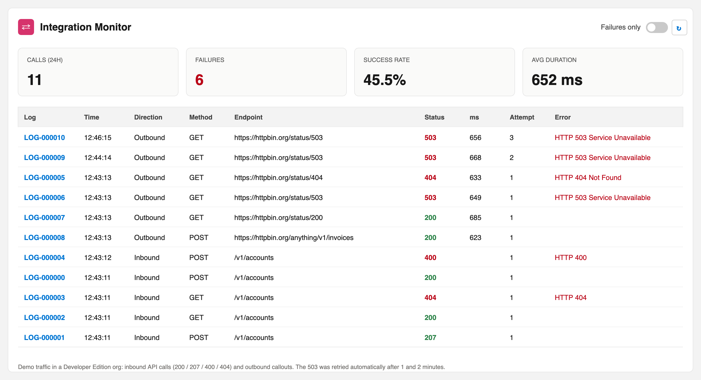

# Salesforce Integration Framework

A reusable, production-style framework for **REST integrations on Salesforce**. It covers both directions:

- **Inbound**: an Apex REST API that external systems (ERP, billing, MDM) call to keep Accounts in sync
- **Outbound**: a callout service with automatic retries and exponential backoff

Every call in either direction is logged through a **Platform Event**, so the log survives even when the business transaction rolls back. Admins watch all of it in the **Integration Monitor** Lightning Web Component and can retry a failed call with one click.



*Integration Monitor with real log records from demo traffic in a Developer Edition org: the 503 was retried automatically after 1 and then 2 minutes, then stopped after the third attempt.*

## Why I built it

Most integration incidents I have debugged come down to the same questions: *Did the call happen? What exactly was sent? Why did it fail, and can we safely send it again?* This framework answers those questions by design. Each call has a correlation id that travels in the `X-Correlation-Id` header, temporary failures are retried automatically, and every request and response is stored where an admin can find it.

## Architecture

```
External system ──POST /services/apexrest/v1/accounts──▶ AccountSyncResource ──▶ AccountSyncService (upsert by External_Id__c)
                                                              │
Salesforce code ──▶ RetryableCalloutJob (Queueable) ──▶ HttpCalloutService ──▶ External API
                         ▲  retry with backoff                │
                         └──────── 408 / 429 / 5xx / timeout ─┤
                                                              ▼
                                         IntegrationLogger ──▶ Integration_Log_Event__e (Publish Immediately)
                                                                         │ trigger
                                                                         ▼
                                                   Integration_Log__c ──▶ integrationLogViewer (LWC)
```

## Components

| Component | What it does |
|---|---|
| `AccountSyncResource` | `@RestResource` API. `POST /v1/accounts` upserts up to 200 accounts; `GET /v1/accounts/{externalId}` reads one. Returns **200**, **207** (partial success, one result per row), **400** or **404**, and echoes the correlation id |
| `AccountSyncService` | Validation (required fields, length, duplicates in the same request) and `Database.upsert` on `External_Id__c` in **user mode**, so object, field and sharing security are enforced |
| `HttpCalloutService` | One entry point for outbound REST calls. Adds the correlation id, measures duration, and classifies failures as **retryable** (timeouts, 408, 429, 5xx) or **permanent** (4xx) |
| `RetryableCalloutJob` | `Queueable` + `Database.AllowsCallouts`. Retries temporary failures up to 3 times with exponential backoff (1, 2, 4 minutes, capped at 10) using delayed Queueables |
| `IntegrationLogger` | Buffers log entries and publishes `Integration_Log_Event__e` (**Publish Immediately**), so logs are kept even if the caller's transaction fails |
| `IntegrationLogEventTrigger` | Subscribes to the event and writes `Integration_Log__c` records |
| `integrationLogViewer` (LWC) | 24-hour summary (calls, failures, success rate, average duration), recent calls in a `lightning-datatable`, a *Failures only* filter, and a **Retry** row action |
| `IntegrationLogController` | `@AuraEnabled` Apex for the component: dynamic SOQL with `Database.queryWithBinds` in user mode, aggregate summary, retry |
| `Integration_Framework_User` | Permission set for the API, the logs and the Integration Monitor tab |

## Example

```bash
curl -X POST "$INSTANCE_URL/services/apexrest/v1/accounts" \
  -H "Authorization: Bearer $ACCESS_TOKEN" \
  -H "Content-Type: application/json" \
  -H "X-Correlation-Id: erp-batch-0425" \
  -d '[{"externalId":"ERP-1001","name":"Northwind Traders","industry":"Retail"},
       {"externalId":"","name":"Missing id"}]'
```

```json
HTTP/1.1 207
[
  {"index":0,"externalId":"ERP-1001","success":true,"created":true,"id":"001...","errors":[]},
  {"index":1,"externalId":"","success":false,"created":false,"errors":["externalId is required"]}
]
```

Outbound, from any Apex code:

```apex
System.enqueueJob(new RetryableCalloutJob(
    new HttpCalloutService.CalloutRequest('POST', 'callout:Billing_API/v1/invoices', JSON.serialize(invoice))
));
```

Use a **Named Credential** (`callout:Billing_API`) so that no URL or secret is stored in code.

## Tests

**23 Apex tests, all passing, with 97% code coverage** (272 of 279 lines), run on a Developer Edition org.

They cover success, partial success, malformed and oversized requests, strict JSON parsing, 404 lookups, retryable and permanent failures, timeouts, backoff limits, body truncation, the event-to-record trigger, the summary maths and the retry rules. Highlights:

- `HttpCalloutMock` for every callout scenario, including a simulated timeout
- `Test.getEventBus().deliver()` to assert on records written by the Platform Event trigger
- `System.runAs` with a Standard User plus the permission set, so that user-mode security is really tested

## Deploy

```bash
sf org login web --alias integration-org
sf project deploy start --source-dir force-app --target-org integration-org
sf org assign permset --name Integration_Framework_User --target-org integration-org
sf apex run test --class-names AccountSyncResourceTest HttpCalloutServiceTest RetryableCalloutJobTest IntegrationLogControllerTest \
  --result-format human --code-coverage --target-org integration-org
```

Then open the **Integration Monitor** tab. For outbound calls, add a Named Credential (or a Remote Site Setting) for the system you call.

## Design decisions

- **Publish Immediately platform events for logging.** A normal insert would be rolled back together with the failed transaction, which is exactly when the log is needed most.
- **Buffered logging.** Callouts cannot follow uncommitted work in the same transaction, so log entries are collected and published once, after the callouts.
- **Partial success (207) instead of all-or-nothing.** One bad row in a batch of 200 should not block the other 199, and the caller gets the reason for every row.
- **Only temporary failures are retried.** Retrying a 400 just repeats the same error, while backoff gives a struggling server room to recover.
- **User mode everywhere a user is involved.** `AccessLevel.USER_MODE` and `WITH USER_MODE` enforce CRUD, FLS and sharing without hand-written checks.

## Author

**Poornima Srivastava**: Salesforce Developer & Consultant, 6× Salesforce Certified
[LinkedIn](https://www.linkedin.com/in/poornima-srivastava-9569b0156/) · [Trailhead](https://www.salesforce.com/trailblazer/psrivastava117) · [Record Access Explainer](https://github.com/poornima7275/record-access-explainer)
